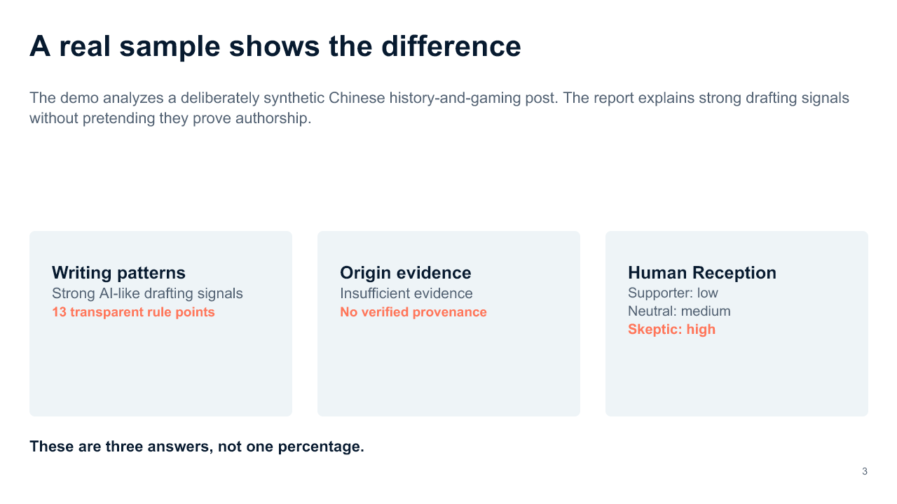

<div align="center">


# SocialMedia GPTHalf

**Three questions. Not one “AI percentage.”**

Origin evidence · Writing patterns · Likely reader reactions  
来源证据、文本模式、读者感受，分开判断。

[](SKILL.md)
[](#see-a-real-sample)
[](LICENSE)

[Demo](#see-a-real-sample) · [Quick start](#quick-start) · [How it works](#how-the-pieces-fit) · [Evidence boundaries](#evidence-not-accusation) · [中文](#中文)

</div>

A Codex Skill and Python CLI for examining public social-media content without pretending that an uncalibrated detector can establish authorship. It keeps provenance, visible writing patterns, and inferred audience reactions separate, with quoted evidence and explicit limits.

## See a real sample

[](demo/devpost/SocialMedia-GPTHalf-Demo.mp4)

[Watch the narrated demo](demo/devpost/SocialMedia-GPTHalf-Demo.mp4) · [Read the synthetic input](demo/sample-case.json) · [Inspect the supplied reception analysis](demo/sample-reception.json)

The included Chinese history-and-gaming parody deliberately has strong templated writing patterns but no verified origin evidence. Running the sample produces:

| Separate question | Sample result | What it does **not** mean |
| --- | --- | --- |
| Are recognizable drafting patterns present? | `strong_ai_like_drafting_signals`; rule indicator **13** | Not 13%, not a calibrated probability, not proof of AI authorship |
| Is there verified AI-origin evidence? | `insufficient_evidence`; confidence `low` | Missing evidence does not establish human authorship |
| How might readers react? | Supplied supporter / neutral / skeptic views have low / medium / high aversion risk | These are inferred personas, not measured audience reactions |

The slide is an existing project demo artifact, not a live product screenshot. The CLI validates and incorporates the supplied reception JSON; it does not independently generate those reader views during this offline run.

## Quick start

### Run the reproducible sample

Use Python 3. A virtual environment keeps the project dependencies isolated:

```bash
git clone https://github.com/yuzhang-zhong/socialmedia-gpthalf.git
cd socialmedia-gpthalf
python -m venv .venv
# macOS / Linux
source .venv/bin/activate
# Windows PowerShell: .venv\Scripts\Activate.ps1
python -m pip install -r scripts/requirements.txt

python scripts/social_ai_check.py analyze \
  --input demo/sample-case.json \
  --reception demo/sample-reception.json \
  --output-dir demo/run --format both
```

Read `demo/run/report.md` or consume `demo/run/report.json`. This bundled text-only example needs no API key and makes no external image-analysis request. Its `example.com` source URL is a synthetic identifier, not evidence from a retrieved page.

### Use it as a Codex Skill

From the project where you want the Skill available:

```bash
git clone https://github.com/yuzhang-zhong/socialmedia-gpthalf.git \
  .agents/skills/socialmedia-gpthalf
```

Install the requirements from that cloned directory, reload your host's Skills, then ask:

```text
Use $socialmedia-gpthalf to analyze this public social media post.
Keep AI-origin evidence separate from writing patterns and likely reader reactions.
```

The Skill workflow can work from public URLs, pasted text, images, or combinations when its host has the necessary tools. The standalone CLI consumes a structured case file; it is not a general-purpose crawler. See the [input/output contract](references/input-output-contract.md).

## How the pieces fit

| Layer | Responsibility | Main entry point |
| --- | --- | --- |
| Host Agent / Skill | Gather authorized public context; draft reader analysis before detector results; explain findings | [`SKILL.md`](SKILL.md) |
| Case and reception validation | Check schema, source scope, quoted support and persona structure | [`social_ai_check.py`](scripts/social_ai_check.py), [`reception_schema.py`](scripts/reception_schema.py) |
| Local text analysis | Describe Simplified-Chinese sentence/document patterns with transparent rules | [`local_text_detector.py`](scripts/local_text_detector.py), [`style_signals.py`](scripts/style_signals.py) |
| Provenance and optional providers | Inspect available C2PA evidence and separately authorized external image analysis | [`c2pa_verify.py`](scripts/c2pa_verify.py), [`providers.py`](scripts/providers.py) |
| Report | Preserve separate origin, practical-pattern and reception conclusions | [`evidence.py`](scripts/evidence.py) |

The OpenAI Build Week demo was built with Codex and used GPT-5.6 for its reasoning layer. That describes the demo workflow, not a mandatory model dependency embedded in the offline CLI. Runtime dependencies are pinned/ranged in [`scripts/requirements.txt`](scripts/requirements.txt).

## Evidence, not accusation

- Style can be produced by people, templates, translators, or language models. The local heuristic is **not a calibrated AI detector**.
- Negative reader reactions do not prove AI use. Persona analysis is speculative and may miss the intended genre, joke, or audience.
- Provenance for one image does not automatically apply to the caption or the whole post. Missing or stripped metadata is inconclusive.
- External image analysis requires permission **for each image**; do not silently send private media to a provider.
- This project does not monitor accounts, bulk-scan posts, or make enforcement decisions. Do not use reports for punishment, hiring, legal findings, school sanctions, or automatic bans.

## Verify and extend

```bash
python -m unittest discover -s scripts/tests
```

The 86-test suite checks implementation behavior, validation, and safety boundaries. Passing tests are **not** evidence of real-world accuracy, recall, or false-positive rates. The optional external provider still requires its own configuration and authorization.

- [Evidence policy](references/evidence-policy.md) · [Local text method](references/local-text-detection.md)
- [Human reception protocol](references/human-reception.md) · [Evaluation protocol](references/evaluation-protocol.md)
- [Research basis](references/research-basis.md) · [Platform workflow](references/platform-workflow.md)

## 中文

SocialMedia GPTHalf 是一个分析公开社交内容的 Codex Skill 和 Python CLI。它不把“像不像 AI”“有没有来源证据”“读者是否反感”揉成一个貌似精确的百分比。

### 先看示例，再看结论

上方真实演示文件使用仓库自带的**合成中文帖子**。离线命令可复现三个不同结果：文本规则点数为 13，来源证据不足，预先提供的支持者 / 中立者 / 怀疑者分析分别给出低 / 中 / 高反感风险。**规则点数不是 AI 率；读者分析不是实测调查。** CLI 负责验证和纳入 `sample-reception.json`，不是在本地自动生成这些观点。

按照 Quick start 克隆、安装依赖后，运行示例即可得到 Markdown 与 JSON 报告，无需 API key。完整 Skill 可在宿主工具支持时处理公开链接、文本与图片；独立 CLI 读取结构化输入文件，不会因为提供了 URL 就自动抓取网页。

### 使用边界

- 没有 AI 来源证据，不代表已经证明由人类创作。
- 文本模式命中、套话或读者反感，都不能单独认定作者身份。
- 图片来源证据不能随意扩大到配文或整个帖子；外部图片分析需逐张授权。
- 不用于处罚、招聘、司法认定、教育处分或自动封禁。
- 86 项测试验证程序行为与边界，不代表检测准确率或误报率已经得到校准。

## License / 许可证

This project is licensed under the MIT License. See [LICENSE](LICENSE).

本项目采用 MIT 许可证，详情见 [LICENSE](LICENSE)。

<p align="center"><sub>Logo created for SocialMedia GPTHalf with OpenAI ImageGen.</sub></p>
