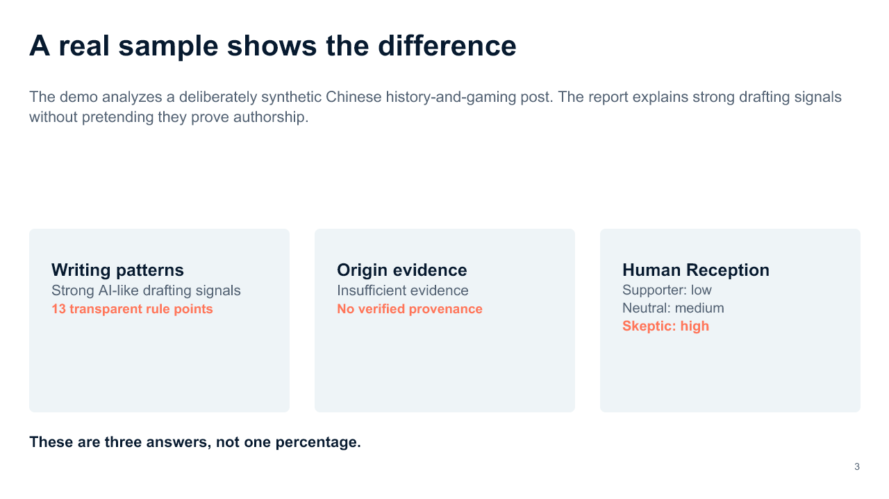

<div align="center">


# SocialMedia GPTHalf

<a id="中文"></a>
**来源证据、文本模式、读者感受，分开判断。**

[English](README.md) · **简体中文**

[](SKILL.md)
[](LICENSE)

[演示](#see-a-real-sample) · [快速开始](#quick-start) · [实现分工](#how-the-pieces-fit) · [证据边界](#evidence-not-accusation)

</div>

用于分析公开社交内容的 Codex Skill 和 Python CLI。报告分别讨论来源、可见的写作模式和推测的读者反应，并附原文证据与限制。未经校准的检测器不能认定作者身份。

<a id="see-a-real-sample"></a>
<a id="先看示例再看结论"></a>
## 先看一个示例

[](demo/devpost/SocialMedia-GPTHalf-Demo.mp4)

[观看配音演示](demo/devpost/SocialMedia-GPTHalf-Demo.mp4) · [查看合成输入](demo/sample-case.json) · [查看预先提供的读者分析](demo/sample-reception.json)

仓库自带的中文历史与游戏仿写样本，有意包含明显的模板化表达，但没有经过验证的创作来源证据。运行样本会得到：

- 写作模式：`strong_ai_like_drafting_signals`，规则点数为 **13**。它不是 13%、校准后的概率，也不是 AI 创作证明。
- 来源证据：`insufficient_evidence`，置信度 `low`。缺少来源证据不能反过来证明人类创作。
- 读者反应：预先提供的支持者 / 中立者 / 怀疑者视角，分别给出低 / 中 / 高反感风险。这些是推测的人设，不是实测受众调查。

上图是项目现有演示材料，不是实时产品截图。CLI 验证并纳入提供的 reception JSON；这个离线流程不会自行生成上述读者观点。

<a id="quick-start"></a>
## 快速开始

<a id="run-the-reproducible-sample"></a>
### 运行可复现样本

需要 Python 3，建议用虚拟环境隔离依赖：

```bash
git clone https://github.com/yuzhang-zhong/socialmedia-gpthalf.git
cd socialmedia-gpthalf
python -m venv .venv
# macOS / Linux
source .venv/bin/activate
# Windows PowerShell: .venv\Scripts\Activate.ps1
python -m pip install -r scripts/requirements.txt

python scripts/social_ai_check.py analyze \
  --input demo/sample-case.json \
  --reception demo/sample-reception.json \
  --output-dir demo/run --format both
```

阅读 `demo/run/report.md`，或处理 `demo/run/report.json`。这个自带的纯文本样本不需要 API key，也不向外部服务发送图片分析请求。`example.com` 来源 URL 是合成标识，不代表已抓取的真实网页证据。

<a id="use-it-as-a-codex-skill"></a>
### 作为 Codex Skill 使用

在希望使用该 Skill 的项目中运行：

```bash
git clone https://github.com/yuzhang-zhong/socialmedia-gpthalf.git \
  .agents/skills/socialmedia-gpthalf
```

在克隆目录中安装依赖，重新加载宿主的 Skills，再提出请求：

```text
使用 $socialmedia-gpthalf 分析这篇公开社交帖子。
请分开讨论 AI 来源证据、写作模式和可能的读者反应。
```

宿主具备相应工具时，Skill 流程可使用公开 URL、粘贴文本、图片或它们的组合。独立 CLI 读取结构化案例文件，不是通用爬虫。详见[输入输出约定](references/input-output-contract.md)。

<a id="how-the-pieces-fit"></a>
## 实现分工

| 层与入口 | 职责 |
| --- | --- |
| 宿主 Agent / Skill<br>[`SKILL.md`](SKILL.md) | 收集获得授权的公开上下文；先写读者分析，再看检测结果；解释发现 |
| 案例与读者分析校验<br>[`social_ai_check.py`](scripts/social_ai_check.py)、[`reception_schema.py`](scripts/reception_schema.py) | 检查 schema、来源范围、引文支持和人设结构 |
| 本地文本分析<br>[`local_text_detector.py`](scripts/local_text_detector.py)、[`style_signals.py`](scripts/style_signals.py) | 用透明规则描述简体中文句子与文档模式 |
| 来源与可选提供商<br>[`c2pa_verify.py`](scripts/c2pa_verify.py)、[`providers.py`](scripts/providers.py) | 检查可用 C2PA 证据，以及获得单独授权的外部图片分析 |
| 报告<br>[`evidence.py`](scripts/evidence.py) | 保留相互独立的来源、实用模式与读者反应结论 |

OpenAI Build Week 演示使用 Codex 构建，并用 GPT-5.6 承担推理层。这描述的是演示工作流，不是离线 CLI 内置的强制模型依赖。运行依赖的固定版本或范围见 [`scripts/requirements.txt`](scripts/requirements.txt)。

<a id="evidence-not-accusation"></a>
<a id="使用边界"></a>
## 证据与使用边界

- 人类、模板、翻译者和语言模型都可能产生相似文风。本地规则**不是经过校准的 AI 检测器**。
- 读者反感不能证明使用了 AI。人设分析带有推测，可能误解体裁、笑话或目标受众。
- 一张图片的来源证据不能自动扩大到配文或整个帖子；元数据缺失或被移除时，结论仍不充分。
- 外部图片分析需要**逐张获得授权**，不能悄悄把私人图片发给提供商。
- 本项目不监控账号、不批量扫描帖子，也不做执法判断。不要用于处罚、招聘、司法认定、教育处分或自动封禁。

<a id="verify-and-extend"></a>
## 校验与扩展

```bash
python -m unittest discover -s scripts/tests
```

86 项测试覆盖实现行为、输入校验和安全边界。测试通过**不代表**真实世界的准确率、召回率或误报率已经得到验证。可选外部提供商仍需要单独配置与授权。

- [证据策略](references/evidence-policy.md) · [本地文本方法](references/local-text-detection.md)
- [读者反应协议](references/human-reception.md) · [评估协议](references/evaluation-protocol.md)
- [研究依据](references/research-basis.md) · [平台工作流](references/platform-workflow.md)

<a id="license--许可证"></a>
## 许可

本项目采用 MIT License，详见 [LICENSE](LICENSE)。

<p align="center"><sub>SocialMedia GPTHalf 标志使用 OpenAI ImageGen 制作。</sub></p>
